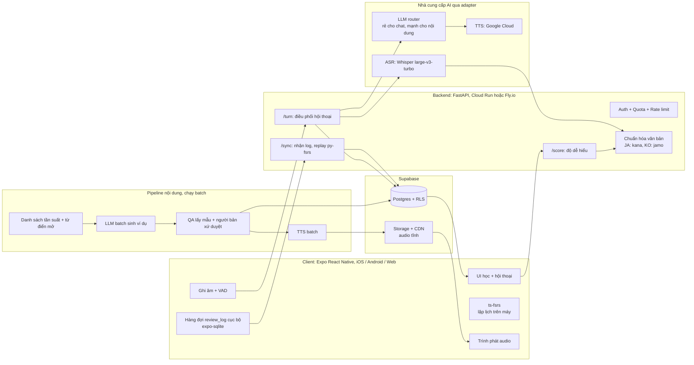
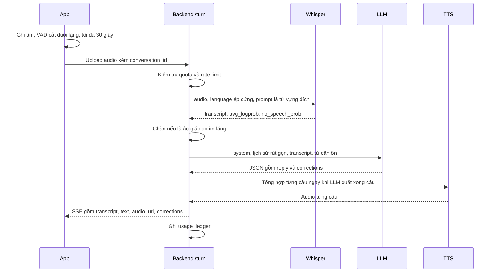
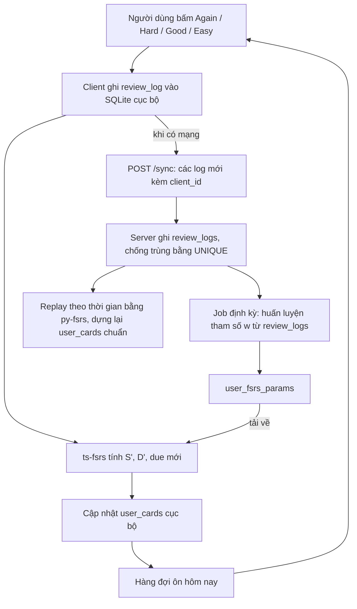

# Kiến trúc hệ thống: Ứng dụng học ngoại ngữ AI (Anh / Nhật / Hàn)

> **Trạng thái:** v0.1, tổng hợp từ phiên thảo luận thiết kế. Giá API ở mục 10 đọc từ trang nhà cung cấp tháng 11/2026 và **biến động nhanh**: kiểm tra lại trước khi chốt ngân sách.
> **Nhãn:** `[ĐÃ XÁC MINH]` có nguồn · `[SUY LUẬN]` · `[GIẢ ĐỊNH]`.

---

## 1. Nguyên tắc kiến trúc

1. **Nội dung tĩnh sinh một lần, offline** (từ vựng, câu ví dụ, audio). Chỉ hội thoại gọi AI thời gian thực, nên chi phí biến đổi tập trung ở hội thoại.
2. **Mọi nhà cung cấp AI qua lớp adapter** (ASR, LLM, TTS, về sau S2S). Giá và model đổi theo quý.
3. **Whisper là ASR, không phải bộ chấm phát âm.** MVP chấm "độ dễ hiểu"; chấm âm vị là giai đoạn sau với mô hình âm học chuyên biệt.
4. **Đa ngôn ngữ từ ngày 1**: thêm ngôn ngữ là thêm dữ liệu và cấu hình, không sửa kiến trúc.
5. **Log bất biến là nguồn sự thật** cho SRS; trạng thái thẻ có thể dựng lại bằng replay.

---

## 2. Sơ đồ thành phần



---

## 3. Luồng một lượt hội thoại



**Ghi chú ASR.** `[ĐÃ XÁC MINH]` Whisper large-v3-turbo trên Groq chỉ hỗ trợ transcribe theo file, không streaming; vì vậy dùng giao diện nhấn giữ hoặc VAD cắt cuối câu rồi gửi cả đoạn.
**Độ trễ ước lượng** đến âm thanh đầu tiên: ASR 0,4–0,8 s + LLM token đầu 0,3–0,8 s + TTS câu đầu 0,3–0,6 s ≈ **1,5–2,5 s** `[GIẢ ĐỊNH]`, phải đo thực tế. Giảm độ trễ bằng cách TTS theo từng câu khi LLM còn đang sinh.

---

## 4. Luồng SRS và đồng bộ



**Phạm vi MVP:** hàng đợi log cục bộ rồi đẩy lên khi có mạng, khóa idempotency `(user_id, card_id, reviewed_at)`. Đồng bộ hai chiều đa thiết bị là v2.

---

## 5. Tech stack

| Tầng | Lựa chọn | Lý do | Khi nào đổi |
|---|---|---|---|
| Client | Expo (React Native) + TypeScript + Expo Router | Một codebase cho iOS, Android, Web | Cần đồ họa nặng: Flutter |
| Dữ liệu cục bộ | `expo-sqlite` | Đủ cho hàng đợi log | Cần đồng bộ đa thiết bị: PowerSync hoặc tương tự |
| Backend | FastAPI (Python 3.11) | Hệ sinh thái NLP Nhật/Hàn, dễ thêm wav2vec2 sau | Đội chỉ biết JS: Edge Functions |
| DB, Auth, Storage | Supabase (Postgres + RLS) | Dựng nhanh, chuẩn SQL nên dễ chuyển đi | Tải lớn: Postgres tự quản + R2 |
| SRS | `ts-fsrs@5.4.2` (client) + `fsrs==6.3.3` / py-fsrs (server), cùng FSRS-6 | Thư viện upstream, có golden vectors chung | Có dữ liệu lớn: tự huấn luyện |
| ASR | Whisper large-v3-turbo (Groq) | Rẻ, nhanh, API tương thích OpenAI | Cần streaming: Deepgram hoặc tự host |
| LLM | Model nhỏ rẻ cho hội thoại; model mạnh cho sinh nội dung (batch) | Cân bằng chi phí và chất lượng | Chạy bộ test 50–100 kịch bản để chọn |
| TTS | Google Cloud TTS, tạo sẵn cho nội dung tĩnh | Giá theo ký tự | Chất lượng JA/KO chưa đạt: so thêm nhà cung cấp |
| Quan sát | PostHog + Sentry + bảng `usage_ledger` | Phải biết chi phí trên mỗi người dùng | |
| Thanh toán | Hoãn sau MVP | Giảm phạm vi | |

**Gói dữ liệu LLM:** dùng gói trả phí cho dữ liệu người dùng thật; gói miễn phí của một số nhà cung cấp có thể dùng dữ liệu để cải thiện sản phẩm (kiểm tra điều khoản từng nhà cung cấp).

---

## 6. FSRS: quy tắc triển khai

- **Phiên bản đã chốt:** `ts-fsrs@5.4.2` trên client và `fsrs==6.3.3` (tên package Python của py-fsrs) trên server; cả hai chạy FSRS-6. Số phiên bản package không cần giống nhau, nhưng thuật toán và cấu hình phải khớp. Đối chiếu upstream ngày 23/11/2026: [ts-fsrs v5.4.2](https://github.com/open-spaced-repetition/ts-fsrs/releases/tag/v5.4.2), [py-fsrs v6.3.3](https://github.com/open-spaced-repetition/py-fsrs/releases/tag/v6.3.3).
- Cấu hình vectors: desired/request retention 0.90; learning steps 2 phút và 10 phút; relearning step 10 phút; fuzzing tắt; maximum interval 36.500 ngày; thời gian UTC. Learning steps được chốt để hai thư viện làm tròn thời điểm Hard giống nhau.
- **Golden test vectors dùng chung** tại `packages/fsrs-golden/vectors.json`, chạy trên client lẫn server; kiểm tra state, step, stability, difficulty, due, reps và lapses.
- Mapping state trong DB: `0 New`, `1 Learning`, `2 Review`, `3 Relearning`. `review_logs` là outbox append-only cục bộ rồi đồng bộ idempotent theo `(user_id, card_id, reviewed_at)`.
- Hàng đợi tự ghi danh nội dung `sampled`/`verified` theo ngôn ngữ đích, chỉ trong phần hạn mức còn lại; thẻ review đến hạn xếp trước thẻ mới. `new_cards_per_day` mặc định 10, giới hạn 0–15/ngày theo ngày Việt Nam. RPC Supabase là nơi xác thực giới hạn; không cho client tự sửa trường `profiles.new_cards_per_day`.
- SM-2 được giữ làm comparator. Chạy mô phỏng 90 ngày trong tình huống giả định (mỗi ngày một phiên, thêm 10 thẻ mới/ngày, mọi câu trả lời đều Good) bằng `python -m scripts.simulate_srs` tại `services/api`. Kết quả chỉ mô tả kịch bản mô phỏng, không phải dự báo người dùng thật.

---

## 7. Chấm "độ dễ hiểu" (MVP)

**Đo gì:** "một ASR mạnh có hiểu bạn không", **không phải** độ chính xác âm vị.

```python
def norm(text, lang):
    if lang == "ja": return to_hiragana(text)      # SudachiPy hoặc pykakasi
    if lang == "ko": return decompose_jamo(text)   # thư viện jamo
    return re.sub(r"[^\w\s']", "", text.lower())

def intelligibility(target, heard, lang):
    tok = list if lang in ("ja", "ko") else str.split   # ký tự hoặc từ
    t, h = tok(norm(target, lang)), tok(norm(heard, lang))
    return round(100 * (1 - edit_distance(t, h) / max(1, len(t))))
```

| Ngôn ngữ | Đơn vị so khớp | Lưu ý |
|---|---|---|
| Anh | Từ (WER) | Whisper có thể "sửa hộ" giọng nên điểm có xu hướng khoan dung |
| Nhật | Kana (CER) | Whisper có thể trả kanji khác câu mục tiêu: chuẩn hóa về hiragana trước; đồng âm khác chữ có thể cho điểm sai |
| Hàn | Jamo (CER) | Nối âm, âm căng làm chuỗi jamo lệch |

**Phòng lỗi vận hành**
1. **Ảo giác khi im lặng:** VAD ở client; kiểm tra `no_speech_prob`, `avg_logprob`; bỏ qua transcript nếu quá thấp.
2. **Ép `language`:** luôn truyền cố định, không để tự nhận dạng.
3. **Thiên vị từ vựng:** truyền danh sách từ đích vào `prompt`.
4. Phản hồi lỗi phải có **bằng chứng** (đoạn lệch cụ thể), không phát biểu lỗi phát âm không kèm căn cứ.

**Giai đoạn sau (v1.1):** mô hình nhận dạng âm vị (wav2vec2), forced alignment, GOP, bộ dữ liệu giọng Việt gán nhãn; thêm `user_phoneme_stats` và cặp tối thiểu (minimal pairs) làm drill. `[ĐÃ XÁC MINH]` Các nghiên cứu cho thấy mô hình audio-language đa năng chưa đáng tin ở cấp âm vị, và bộ benchmark phổ biến Speechocean762 chỉ gồm người nói tiếng Quan Thoại (thiếu đa dạng giọng).

---

## 8. Hợp đồng API (tóm tắt)

### `POST /v1/turn` (SSE)
Yêu cầu: audio (multipart) hoặc `text`, `conversation_id`, `lang`.
Phản hồi cuối:

```json
{
  "transcript": "I go to the market yesterday",
  "asr": { "lang": "en", "avg_logprob": -0.21, "no_speech_prob": 0.01 },
  "reply": { "text": "Oh nice! What did you buy?", "audio_url": "https://cdn.example/r_81.opus" },
  "corrections": [
    { "original": "I go", "corrected": "I went", "type": "tense",
      "explain_vi": "Có 'yesterday' nên dùng quá khứ đơn.", "save_as_card": true }
  ],
  "target_words_used": ["market", "yesterday"]
}
```
Ràng buộc: `corrections` tối đa 2 phần tử mỗi lượt.

### `POST /v1/score`
Yêu cầu: audio, `target_text`, `lang`, `item_id` (tùy chọn).
Phản hồi:

```json
{
  "transcript": "i sink the ship is cheap",
  "intelligibility": 71,
  "diffs": [
    { "type": "substitution", "index": 1, "expected": "think", "heard": "sink" }
  ],
  "asr": { "avg_logprob": -0.3, "no_speech_prob": 0.02 },
  "flags": { "silence_suspect": false }
}
```

### `POST /v1/sync`
Yêu cầu: mảng sự kiện `{card_id, reviewed_at, rating, duration_ms, client_id}`.
Hành vi: ghi `review_logs` (bỏ qua bản trùng), replay theo thời gian để dựng lại `user_cards`, trả về trạng thái thẻ đã cập nhật.

*(OpenAPI 3 đầy đủ: viết sau, dựa trên mục này.)*

---

## 9. Pipeline nội dung và QA

1. Nguồn: danh sách tần suất + từ điển/kho câu ví dụ mở. **Lưu `source` và `license` cho từng dòng**; kiểm tra nghĩa vụ ghi nguồn hoặc chia sẻ tương tự trước khi thương mại hóa.
2. LLM batch (Batch API giúp giảm chi phí) sinh câu ví dụ, nghĩa tiếng Việt, `reading`.
3. QA: `qa_status` đi từ `draft` → `sampled` → `verified`. Với tiếng Nhật và Hàn, **người bản xứ duyệt mẫu**. Chỉ hiển thị cho người học các mục `sampled`/`verified`.
4. TTS batch tạo audio, lưu Storage/CDN.
5. Nút "Báo lỗi" trong app đưa mục trở lại hàng đợi duyệt.

---

## 10. Chi phí

### Giá đầu vào (đọc tháng 11/2026, `[ĐÃ XÁC MINH]` từ trang nhà cung cấp hoặc bài tổng hợp, kiểm tra lại trước khi dùng)

| Thành phần | Giá | Nguồn |
|---|---|---|
| Whisper large-v3-turbo (Groq) | $0,04/giờ audio, tối thiểu tính 10 giây mỗi request | groq.com/pricing |
| Whisper API của OpenAI (so sánh) | $0,006/phút (≈ $0,36/giờ) | bài tổng hợp bên thứ ba |
| LLM dòng Flash-Lite (Gemini) | $0,30 input / $2,50 output mỗi triệu token | ai.google.dev/gemini-api/docs/pricing |
| LLM dòng Flash (Gemini) | Giá giới thiệu $0,75 / $3,75 đến hết 31/12/2026, sau đó $1,50 / $7,50 | bài tổng hợp bên thứ ba |
| Google Cloud TTS | Standard $4 · Neural2 $16 · Chirp 3 HD $30 mỗi triệu ký tự (có hạn mức miễn phí hằng tháng) | cloud.google.com/text-to-speech/pricing |

### Ước tính mỗi lượt (`[SUY LUẬN]`, phép tính)
Giả định mỗi lượt: người dùng nói 10 giây; LLM nhận 1.500 token vào, 150 token ra; câu trả lời 120 ký tự.

| Cấu hình | ASR + LLM + TTS | Mỗi lượt | Mỗi phiên 20 lượt |
|---|---|---|---|
| A. Tiết kiệm | Groq turbo + Flash-Lite + TTS Standard | ≈ $0,0014 | ≈ $0,03 |
| B. Cân bằng | Groq turbo + Flash-Lite + Neural2 | ≈ $0,0029 | ≈ $0,06 |
| C. Cao cấp | Groq turbo + Flash (giá từ 2027) + Chirp 3 HD | ≈ $0,0071 | ≈ $0,14 |

ASR chiếm phần rất nhỏ; **LLM và TTS mới là chi phí chính**.

### Speech-to-speech (so sánh, thí nghiệm H3)
Các mức giá thay đổi nhanh và phụ thuộc cache/tỉ lệ nói; tham khảo bài tổng hợp bên thứ ba (đọc tháng 10/2026): Gemini 3.8 Live khoảng $0,005/phút (vào) + $0,018/phút (ra); gpt-realtime-2.1-mini khoảng $0,023–0,13/phút; gpt-realtime-2.1 khoảng $0,07–0,43/phút tùy cache. Với 300 phút/người/tháng, chênh lệch giữa các phương án từ vài USD đến vài trăm USD: **bắt buộc có định tuyến theo gói và quota**.

### Đòn bẩy giảm chi phí
Hạn mức theo gói; tạo sẵn audio cho câu mở đầu kịch bản; cắt lịch sử hội thoại + context caching; giới hạn `max_output_tokens`; phân tích lỗi chi tiết chạy bất đồng bộ bằng batch; TTS của thiết bị làm phương án dự phòng.

---

## 11. Bảo mật và quyền riêng tư

- **Row Level Security** cho mọi bảng dữ liệu người dùng; `usage_ledger` chỉ ghi bởi service role.
- **Mặc định không lưu audio thô**; xóa sau khi chấm. Chỉ lưu khi người dùng bật `store_raw_audio`.
- Không đưa thông tin định danh cá nhân vào prompt gửi LLM.
- Khóa API chỉ ở biến môi trường phía server; `.env.example` trong repo, `.env` trong `.gitignore`.
- Giọng nói là dữ liệu nhạy cảm: cần chính sách quyền riêng tư và xác nhận pháp lý với luật bảo vệ dữ liệu cá nhân của Việt Nam và thị trường mục tiêu (cần luật sư).
- Rate limit và giới hạn độ dài audio (≤ 30 giây) để chống lạm dụng.

---

## 12. Quan sát và vận hành

- Sự kiện sản phẩm (PostHog): `card_reviewed`, `speak_scored`, `turn_completed`, `correction_saved`, `quota_hit`.
- Lỗi (Sentry). Theo dõi p50/p95 độ trễ từng chặng (ASR, LLM, TTS).
- Bảng điều khiển chi phí từ `usage_ledger`: chi phí/người dùng hoạt động/ngày, cảnh báo vượt ngân sách.

---

## 13. Cấu trúc repo đề xuất

```text
.
├── apps/
│   └── mobile/                # Expo (React Native + Web)
├── services/
│   └── api/                   # FastAPI
│       ├── app/
│       │   ├── routes/        # turn.py, score.py, sync.py
│       │   ├── providers/     # asr.py, llm.py, tts.py (adapter + mock)
│       │   ├── scoring/       # normalize.py, intelligibility.py
│       │   ├── srs/           # fsrs_service.py, sm2.py
│       │   └── quota.py
│       └── tests/
├── packages/
│   └── fsrs-golden/           # test vectors dùng chung client + server
├── db/
│   └── data_model.sql
├── docs/                      # PRD.md, architecture.md, ...
├── .env.example
└── docker-compose.yml
```

---

## 14. Điểm mở cần quyết định

1. Đã chốt thư viện và thuật toán FSRS-6; kiểm tra lại upstream trước khi nâng phiên bản hoặc thay đổi cấu hình.
2. Chọn LLM chính bằng bộ test 50–100 kịch bản Anh/Nhật/Hàn (so các model cùng tầng giá).
3. Nhà cung cấp TTS cho tiếng Nhật và Hàn (nghe thử, người bản xứ đánh giá).
4. Ngưỡng `no_speech_prob`/`avg_logprob` để chặn ảo giác (hiệu chỉnh bằng dữ liệu thật).
5. Thời điểm thử speech-to-speech (thí nghiệm H3).